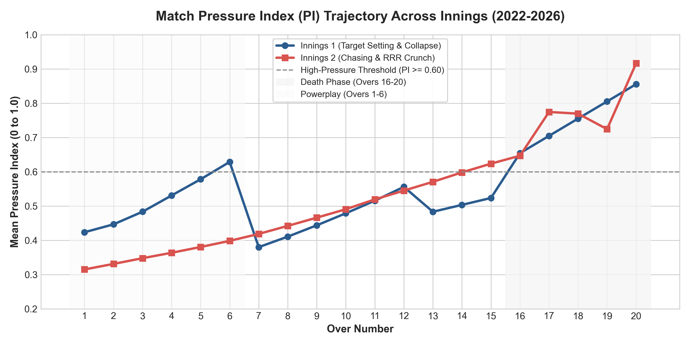
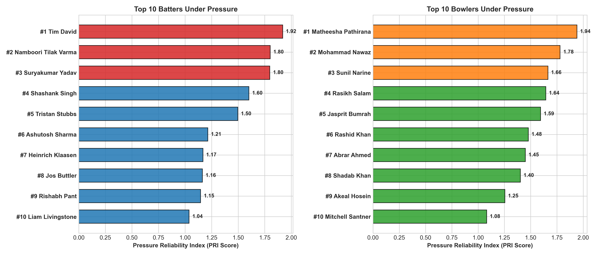
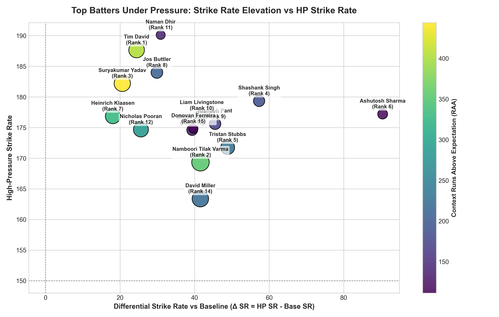
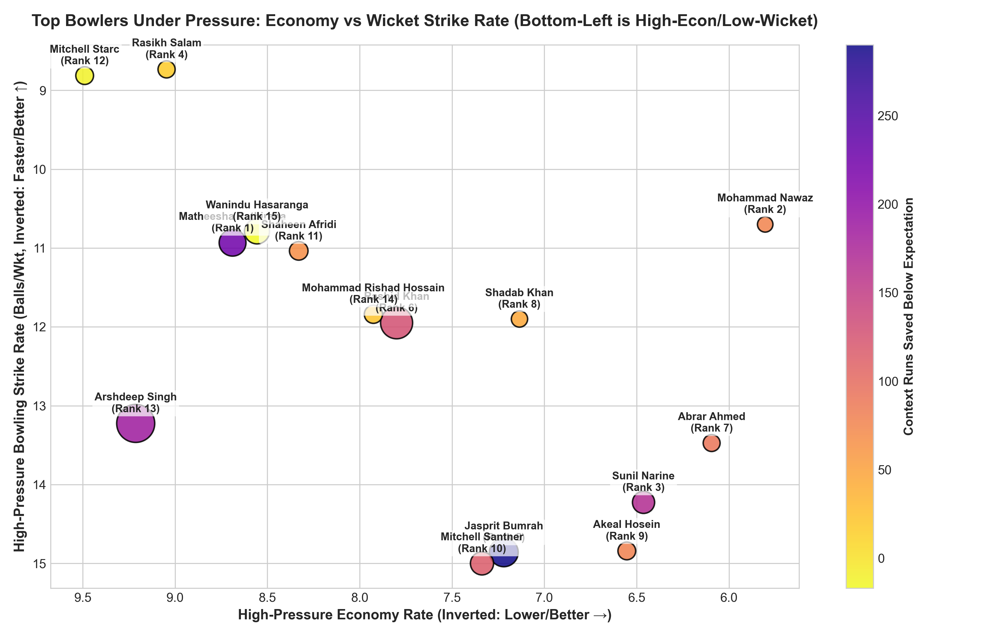

# Rajasthan Royals SupeRR Selector — Season 2
## Identifying the Most Reliable Players Under Pressure in T20 Cricket

> **Live Interactive Dashboard:** [https://tejeshchowdary10.github.io/rajasthan-royals-superr-selector/](https://tejeshchowdary10.github.io/rajasthan-royals-superr-selector/)

---

## 📌 Executive Summary

This repository presents the end-to-end framework, empirical analysis, and interactive dashboard developed for **Rajasthan Royals SupeRR Selector Season 2**. 

Conventional cricket metrics (raw batting averages, raw strike rates, economy rates) fundamentally fail to capture performance under acute match stress because they treat every delivery equally. A dot ball in the 4th over of an uncompetitive group match is counted identically to a dot ball defending 8 runs in the final over of an IPL Playoff.

To resolve this, we engineered a continuous **Delivery-Level Pressure Index ($PI \in [0, 1]$)** and an all-in-one **Pressure Reliability Index (PRI)** evaluated across **200,999 legal balls from 867 IPL and T20I matches (2022–2026)**.

---

## 🏆 Official Top 10 Rankings Under Pressure

### 🏏 Top 10 Batters Under Pressure
| Rank | Player | Innings | HP Balls | HP Strike Rate | Runs Above Exp. (RAE) | Baseline Delta ($\Delta SR$) | Consistency % | **PRI Score** |
|:---:|:---|:---:|:---:|:---:|:---:|:---:|:---:|:---:|
| **1** | **Tim David** | 73 | 480 | **188.75** | **+138.8** | **+23.4** | **68.5%** | **1.92** |
| **2** | **Namboori Tilak Varma** | 70 | 486 | 148.97 | +91.8 | +8.7 | 64.3% | **1.80** |
| **3** | **Suryakumar Yadav** | 82 | 609 | 170.11 | +119.5 | -0.3 | 64.6% | **1.80** |
| **4** | **Shashank Singh** | 33 | 206 | **185.92** | +65.0 | **+23.9** | **66.7%** | **1.60** |
| **5** | **Tristan Stubbs** | 56 | 321 | 165.73 | +63.8 | +10.1 | 62.5% | **1.50** |
| **6** | **Ashutosh Sharma** | 22 | 201 | 175.62 | +47.5 | +9.4 | 54.5% | **1.21** |
| **7** | **Heinrich Klaasen** | 78 | 442 | 167.87 | +68.3 | -3.8 | 57.7% | **1.17** |
| **8** | **Jos Buttler** | 77 | 610 | 149.34 | +59.6 | +1.2 | 59.7% | **1.16** |
| **9** | **Rishabh Pant** | 58 | 468 | 144.66 | +55.5 | +8.5 | 58.6% | **1.15** |
| **10** | **Liam Livingstone** | 63 | 363 | 158.40 | +37.6 | +6.2 | 55.6% | **1.04** |

---

### 🎯 Top 10 Bowlers Under Pressure
| Rank | Player | Innings | HP Balls | HP Economy | Runs Saved (RS) | Wicket Rate | Consistency % | **PRI Score** |
|:---:|:---|:---:|:---:|:---:|:---:|:---:|:---:|:---:|
| **1** | **Matheesha Pathirana** | 51 | 510 | **8.12** | **+89.7** | **7.45%** (38 wkts) | **64.7%** | **1.94** |
| **2** | **Mohammad Nawaz** | 54 | 400 | **7.44** | **+76.9** | 5.50% (22 wkts) | **68.5%** | **1.78** |
| **3** | **Sunil Narine** | 59 | 515 | **6.75** | **+115.0** | 3.50% (18 wkts) | 64.4% | **1.66** |
| **4** | **Rasikh Salam** | 23 | 209 | 8.24 | +32.3 | **8.13%** (17 wkts) | 60.9% | **1.64** |
| **5** | **Jasprit Bumrah** | 50 | 506 | **6.59** | **+120.3** | 4.35% (22 wkts) | 62.0% | **1.59** |
| **6** | **Rashid Khan** | 67 | 609 | 7.64 | +87.9 | 4.43% (27 wkts) | 62.7% | **1.48** |
| **7** | **Abrar Ahmed** | 28 | 273 | 7.21 | +48.9 | 5.86% (16 wkts) | 64.3% | **1.45** |
| **8** | **Shadab Khan** | 47 | 370 | 7.95 | +48.6 | 6.22% (23 wkts) | 63.8% | **1.40** |
| **9** | **Akeal Hosein** | 47 | 344 | 7.27 | +57.0 | 4.36% (15 wkts) | 61.7% | **1.25** |
| **10** | **Mitchell Santner** | 42 | 344 | 7.33 | +55.2 | 4.07% (14 wkts) | 61.9% | **1.08** |

---

## 🔬 Mathematical Architecture

### 1. Delivery-Level Continuous Pressure Index ($PI \in [0, 1]$)
Every ball's context is quantified through 5 composite pillars:
$$PI = \min\left(1.0, \; \Big(0.40 \cdot S_{match} + 0.25 \cdot S_{over} + 0.15 \cdot S_{wicket} + 0.10 \cdot S_{run} + 0.10 \cdot S_{tournament}\Big) \cdot M_{chase}\right)$$

Deliveries with $PI \ge 0.60$ represent the top 33.4% acute pressure moments (67,223 high-pressure deliveries analyzed).

### 2. Pressure Reliability Index (PRI) Formula
For eligible players ($\ge 200$ high-pressure deliveries), PRI synthesizes 4 normalized and calibrated pillars:
$$\text{PRI} = 0.35 \cdot z(\text{Execution}_{EB}) + 0.25 \cdot z(\text{RAE / RS}) + 0.20 \cdot z(\Delta_{\text{Clutch}}) + 0.20 \cdot z(\text{Consistency})$$

1. **Absolute Execution (35%):** Strike rate or economy shrunk via **Empirical Bayes shrinkage** towards population priors ($\alpha=60$ balls) to avoid sample size bias.
2. **Contextual Impact (25%):** Ball-by-ball **Runs Above Expectation (RAE)** or **Runs Saved (RS)** conditioned on the required run rate, over phase, and match leverage.
3. **Clutch Differential (20%):** Performance in high-pressure ($PI \ge 0.60$) minus low-pressure ($PI < 0.60$) deliveries ($\Delta SR$ for batters, $\Delta \text{Econ}$ and $\Delta \text{WktRate}$ for bowlers).
4. **Cross-Match Reliability / Consistency (20%):** Fraction of high-pressure appearances where the player generated positive net match leverage.

---

## 📊 Visualizations

| Pressure Profile Breakdown | Top 10 Pressure Rankings |
|:---:|:---:|
|  |  |

| Batter Clutch Matrix | Bowler Clutch Matrix |
|:---:|:---:|
|  |  |

---

## 💻 Interactive Dashboard Features

The dashboard is built as an ultra-fast, zero-dependency client application:
- **Dual Tab Interface:** Instant switching between Batters and Bowlers.
- **Top 10 Podium & Stat Cards:** High-impact cards with PRI badges, RAE/RS gauges, and key metrics.
- **Comprehensive Data Tables:** All 87 qualified batters and 98 qualified bowlers with instant column search and multi-column sorting.
- **Dynamic Scatter Clutch Matrices:** Interactive Chart.js scatter plots displaying quadrant boundaries (*Clutch Elites, Pressure Chusers, Steady Contributors, Vulnerable*).
- **Head-to-Head Player Comparison Radar:** Select any two players to visually compare Strike Rate/Economy, Consistency, Volume, and PRI side-by-side.
- **Methodology & Documentation Modal:** Built-in explainer of all formulas, thresholds, and data filters.

---

## 📄 Formal Methodology Report
The complete 6-page technical report submitted for the competition is available in this repository:
- 📄 [Download PDF Report](Rajasthan_Royals_SupeRR_Selector_Season_2_Methodology_Report.pdf)

---

## 👤 Author
- **Tejesh Chowdary**
- GitHub: [@TejeshChowdary10](https://github.com/TejeshChowdary10)
